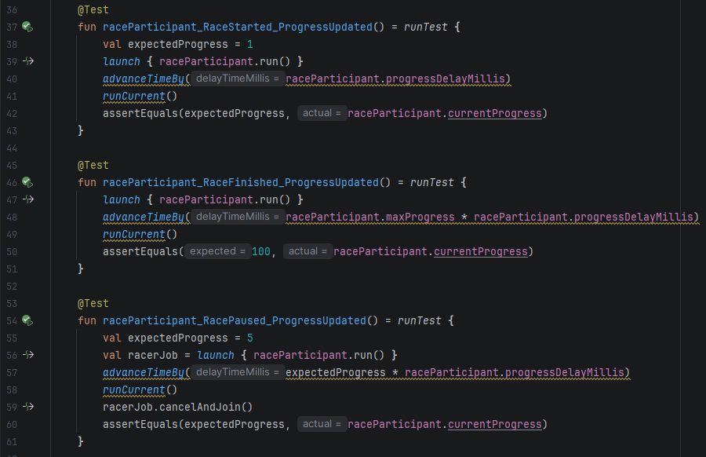
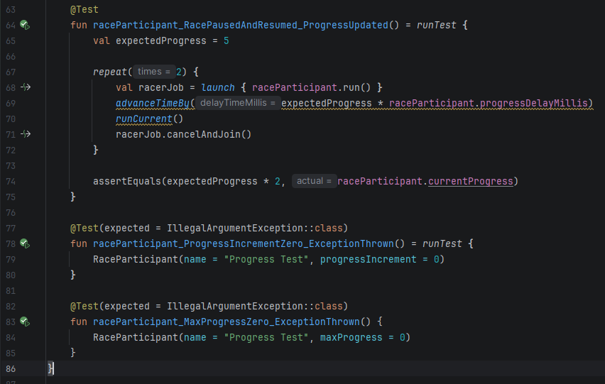

## Codelab: Corrutinas y Pruebas Unitarias (Race Tracker)

En esta etapa del proyecto se implementó y evaluó el manejo de tareas asíncronas utilizando **Corrutinas de Kotlin**. Se desarrolló la lógica concurrente para actualizar el progreso de forma independiente, asegurando su correcto funcionamiento mediante un entorno de pruebas riguroso.

### Conceptos y Tecnologías Aplicadas
* **Concurrencia:** Uso de funciones de suspensión (`suspend`) y constructores como `launch` para ejecutar tareas sin bloquear el hilo principal.
* **Configuración de Entorno (Gradle):** Integración y sincronización de la dependencia `kotlinx-coroutines-test` en el módulo de la aplicación.
* **Manipulación del Tiempo Virtual:** Implementación de `runTest`, `advanceTimeBy()` y `runCurrent()` para simular el paso del tiempo en retardos (`delay`) sin ralentizar la ejecución de la prueba.
* **Aserciones (Assertions):** Validación técnica de los estados y variables esperadas mediante `assertEquals`.

### Evidencia de Pruebas Unitarias

A continuación, se adjunta la evidencia de la ejecución exitosa de la suite de pruebas (`RaceParticipantTest`). Se validaron múltiples escenarios, incluyendo el inicio de tareas, las pausas y las actualizaciones de progreso, garantizando que el código base está libre de errores de sincronización.

Evidencia de ejecución de tests locales

